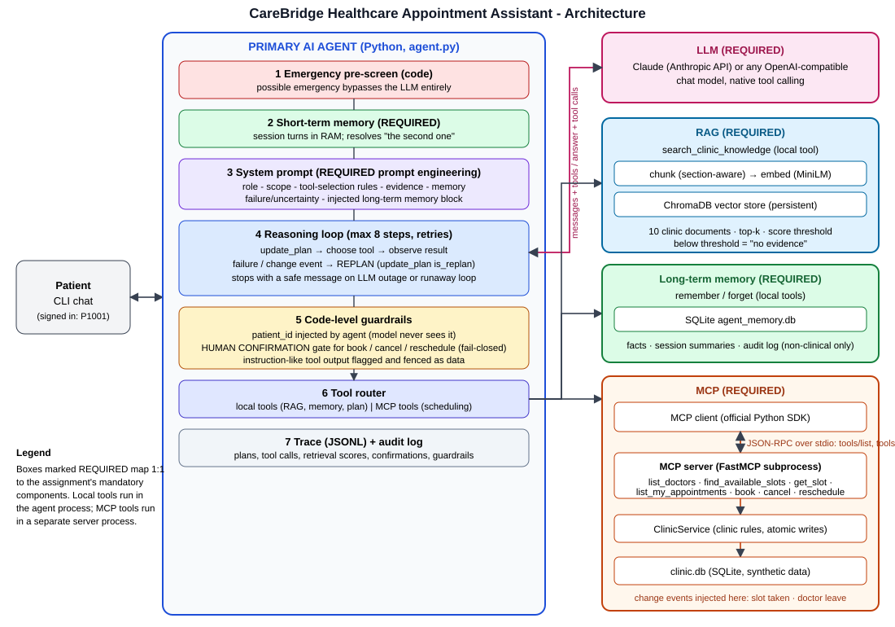

# CareBridge Healthcare Appointment Assistant
**Agent Based Modeling (AIDE3313) - Assignment 2 - Scenario 17: Healthcare Appointment Assistant**

A Python AI agent connected to an LLM that books, cancels and reschedules **simulated** clinic appointments,
answers clinic-policy questions from a document knowledge base (RAG), remembers each patient's scheduling
preferences between sessions, and talks to the clinic's scheduling system through a real **MCP** server.
It plans, **replans when the world changes**, and requires **human confirmation** for every consequential action.
All data is synthetic.



## Requirement checklist
| Required component | Where |
|---|---|
| AI agent + LLM, tool selection visible | `clinic_agent/agent.py`, `llm.py` |
| Short-term memory | `memory.py::ShortTermMemory` |
| Long-term memory (SQLite, new session) | `memory.py::LongTermMemory` |
| RAG (10 docs, chunk, embed, ChromaDB, grounded) | `rag.py`, `data/kb/` |
| MCP server + client (stdio, real tool calls) | `mcp_server.py`, `mcp_client.py` |
| Prompt engineering + justification | `prompts.py`, `docs/prompt_justification.md` |
| Planning / replanning | `update_plan` tool + replan hints in `agent.py` |
| Tests, error handling, oversight | `tests/` (87 tests), `docs/requirements_traceability.md` |

Full mapping to tests and evidence: **`docs/requirements_traceability.md`**.

## Quick start
```bash
python -m venv .venv
source .venv/bin/activate                               # Windows PowerShell: .venv\Scripts\activate
pip install -r requirements.txt
cp .env.example .env                                    # Windows PowerShell: copy .env.example .env
                                                        # then open .env and paste your API key (notepad .env)

python scripts/setup_data.py                            # seed clinic DB + ingest 10 docs into ChromaDB
python -m unittest discover -s tests -v                 # 87 tests, no network/LLM needed (mcp+chromadb installed)
python scripts/check_llm.py                             # verify the LLM connection first
python scripts/run_demo.py                              # the full 3-session demonstration (needs the API key)
python -m clinic_agent.cli --patient P1001              # or chat yourself
```
First run downloads the small embedding model (all-MiniLM-L6-v2, ~80 MB) once.

### Using a different LLM
`LLM_PROVIDER=openai` with `OPENAI_BASE_URL` works for OpenAI, Gemini, Groq, OpenRouter and local Ollama
(see `.env.example`). The agent code does not change.

## Web UI (recommended for demos)
```bash
python -m clinic_agent.web          # opens http://127.0.0.1:8000
```
A live "command centre" on top of the *same* agent: chat with clickable slot cards, an **Agent mind** timeline streaming
plans / replans / MCP tool calls / RAG retrieval scores / memory writes / guardrails as they happen, a **human-confirmation
dialog** for every booking change, live appointments, an editable long-term-memory view with the audit log, a knowledge-base
search that visualises the evidence cut-off, simulation buttons for the two change events, dark/light theme.
Use the sidebar to switch patients (P1003 is a new patient and cannot book specialists).

**Suggested live demo:** (1) *Find a dermatologist* card -> watch plan, MCP call and slot cards; (2) click **Slot gets taken**
then book a slot -> `SLOT_UNAVAILABLE` -> amber **Replan** card -> alternatives; (3) **New session** -> memory is applied unprompted;
(4) **Doctor goes on leave** -> ask "check my appointment" -> replan; (5) type "I have chest pain" -> guardrail answered by code.

## What the demo shows (`scripts/run_demo.py`)
| Session | Demonstrates |
|---|---|
| 1 | preferences saved to memory; **RAG** answer with citation; **short-term memory** ("book the second option"); **change event #1**: the slot is taken just before booking -> **REPLAN** -> rebook after **human confirmation** |
| 2 | **new session** (new process, new MCP server): long-term memory applied without being told again; a question the documents cannot answer -> grounded "I couldn't find that" |
| 3 | **change event #2**: doctor on leave, the clinic cancels the appointment -> agent notices, **REPLANS** with remembered preferences; then guardrail probes: medical-advice request, another patient's data, a cancellation the patient **declines** at the confirmation prompt, forgetting a stored preference, and a possible **emergency** (answered by code, LLM bypassed) |

Output: console trace, `evidence/demo_transcript.md`, `logs/trace_*.jsonl`. Use `--interactive` to answer the
confirmation prompts yourself. Other useful commands:
```bash
python scripts/query_kb.py "how much is the late cancellation fee"   # RAG retrieval evidence, no LLM
python scripts/inject_change_event.py doctor-leave --patient P1001   # break the world on demand
python -m clinic_agent.mcp_server                                    # run the MCP server standalone
```

## Design highlights
* **Plan and replan as first-class tool calls.** `update_plan` records goal, steps, the tool for each step and why. When a
  tool returns `ok=false`, the agent code appends a replan hint; the model then calls `update_plan(is_replan=true)`.
* **Guardrails in code, not only in the prompt:** emergency pre-screen bypasses the LLM; `patient_id` is hidden from the
  model and injected by the agent; book/cancel/reschedule run only after a human approves details fetched fresh from
  the MCP server (fail-closed); instruction-like tool output is flagged and fenced.
* **Privacy by design:** long-term memory is a whitelist of non-clinical categories and rejects medical content;
  patients can ask to forget; every consequential action is audit-logged.
* **RAG that can say "I don't know":** below a similarity threshold nothing is returned and the agent must say it has no evidence.
* **Testable:** business rules sit in `ClinicService` (pure Python); MCP is a thin wrapper; the LLM is an interface with a
  scripted test double, so 66 deterministic tests cover plumbing, rules and failure cases.

## Limitations (be honest in the report)
* Short-term memory keeps the last 12 turns; older turns are dropped (durable facts live in long-term memory).
* The clinical-content filter for memory is a keyword heuristic, not a classifier.
* Authentication is simulated (patient id chosen at start-up).
* The hash embedder used in unit tests is lexical only; production retrieval uses a neural embedder.
* Model behaviour (e.g. wording, citing sources) is probabilistic; the guarantees listed above are enforced in code.

## Project layout
```
clinic_agent/   agent.py llm.py prompts.py memory.py rag.py mcp_server.py mcp_client.py
                clinic_tools.py clinic_db.py safety.py tracing.py runtime.py cli.py config.py
data/kb/        10 synthetic clinic documents (RAG corpus)
web/            index.html styles.css app.js  (the UI; no build step)
scripts/        setup_data.py run_demo.py query_kb.py inject_change_event.py
tests/          87 tests + ui_logic_test.js      docs/   architecture, prompt justification, traceability
evidence/       demo transcript (generated)
```
