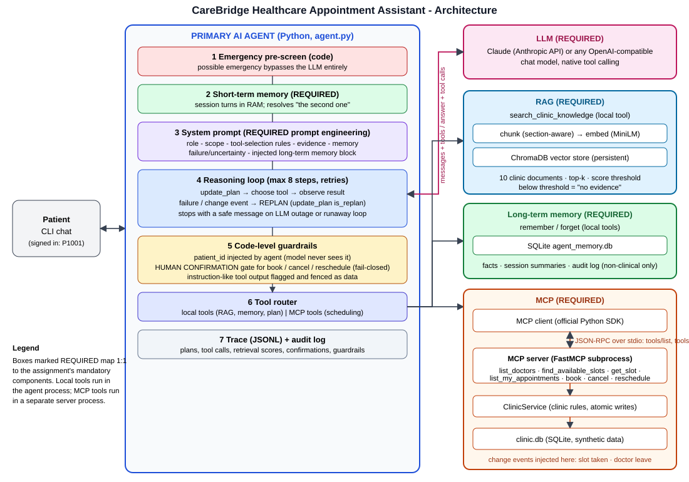
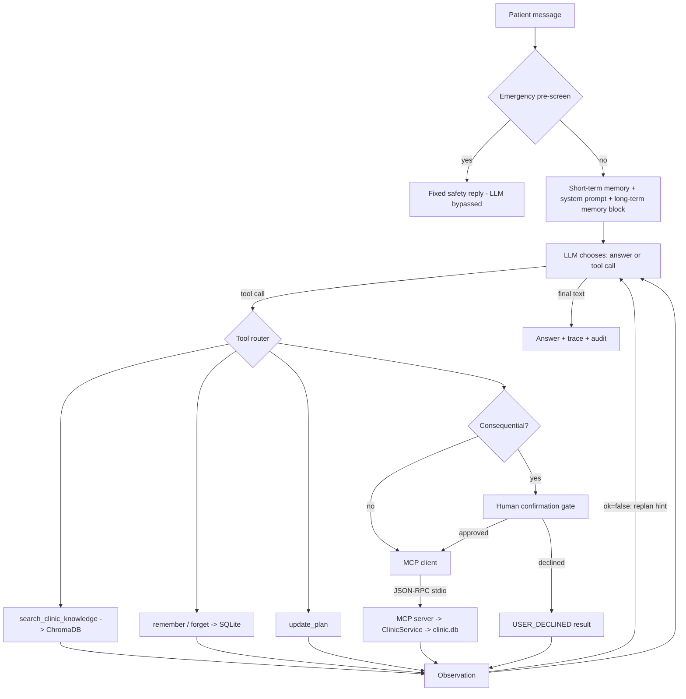

# Architecture

## Request flow (one patient message)

## Why these components are separate
* **RAG knowledge base vs long-term memory.** The knowledge base holds clinic-wide documents (same for everyone, read-only,
  embedded and searched by similarity). Long-term memory holds patient-specific facts told to the assistant (key-value rows
  in SQLite, loaded in full at session start, deletable by the patient). Different data, different access pattern.
* **MCP server vs local tools.** Scheduling is an external system with its own rules and its own process; MCP gives a
  standard discovery/call protocol and process isolation. Retrieval and memory are internal capabilities of the agent.
* **Business rules in `ClinicService`, protocol in `mcp_server.py`.** Rules are unit-testable without MCP, and the agent
  cannot bypass them.
